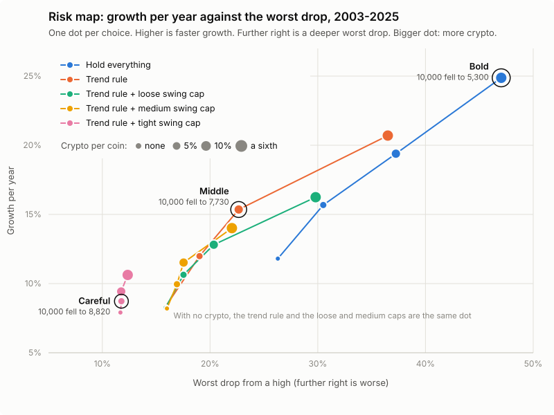

# Risk map: how big a drop, how much crypto

For the owner. Built 2026-11-12 by `lib/risk_map.py` (research run 3); card `cards/risk-map.md`.

**The question.** How big a worst drop could you stomach, and how much crypto do you want? No
backtest can answer that for you. This page shows what each answer would have meant in money.

**What was done.** The same six assets (SPY, QQQ, TLT, GLD, BTC, ETH) run 20 ways: five rules
times four crypto sizes, fake money, real prices with dividends, trading costs included. No new
ideas and nothing tuned: these are the rules from runs 1 and 2 at different settings.

**How to read it.** Each dot is one choice. Higher means the account grew faster. Further right
means its worst fall from a high was deeper. Colour is the rule; a bigger dot holds more crypto.
The dots form one rising band: every step up in growth came with a deeper drop. There is no dot
in the top-left corner, and the research found no rule that puts one there.

## Three presets

Numbers are for 2003-2025. "Fell to" is what 10,000 at the account's high had shrunk to at the
bottom of its worst drop.

| Preset | What it is | Growth a year | Worst drop | 10,000 fell to, at worst | Time to recover | Worst calendar year | Longest wait for a new high | Held in crypto / in cash, on average | 1994-2025: worst drop |
|---|---|---:|---:|---:|---:|---:|---:|---:|---:|
| **Careful** | Trend rule + tight swing cap, crypto 5% per coin | 9% | 12% | **8,820** | 5 months | -10% (2022) | 2.2 years | 2% / 37% | 18% (8,210) |
| **Middle** | Trend rule, crypto 10% per coin | 15% | 23% | **7,730** | 5 months | -14% (2018) | 2.4 years | 14% / 30% | 29% (7,110) |
| **Bold** | Hold everything, crypto a sixth per coin | 25% | 47% | **5,300** | 2.1 years | -36% (2022) | 2.3 years | 33% / 0% | 69% (3,120) |

- **Careful.** Hold an asset only while it is up over the last year, hold less of anything
  that swings a lot, and keep crypto small. 10,000 fell to about 8,820 at
  worst. The worst drop ran from February 2020 to March 2020; the account was back at its old high in July 2020. The price is slow growth: 9% a year where Bold made
  25%.
- **Middle.** The plain trend rule, with 10% of the account for each coin. 10,000 fell to
  about 7,730 at worst. The worst drop ran from February 2020 to March 2020; the account was back at its old high in July 2020.
- **Bold.** Hold all six in equal parts, always. The fastest growth on the menu, and 10,000
  fell to about 5,300: nearly half gone. The worst drop ran from January 2018 to December 2018; the account was back at its old high in February 2020.
- **Where the paper lane is today.** Its trend strategy uses equal slots and a medium swing
  cap, so the nearest row is "Trend rule + medium swing cap" with a sixth per coin. That
  lands beside Middle by another route: growth 14% a year, worst drop
  22%, 10,000 fell to 7,800.

To choose: go down the "fell to" column and stop at the lowest figure you could watch without
selling. That row is your answer. Then expect worse than that figure one day: a worst drop is
only the worst so far.

## What moves a dot

- **Crypto size moves it most.** Holding everything, from no crypto to a sixth per coin:
  growth 12% to 25% a year, worst drop 26% to 47%.
- **The trend rule buys a shallower drop and pays for it in growth.** At a sixth per coin,
  from holding to the trend rule: growth 25% to 21% a year, worst drop 47% to 36%. At 5% per coin:
  growth 16% to 12% a year, worst drop 31% to 19%. It is insurance, not extra return. On average it keeps
  about 30% of the account in cash.
- **The swing cap is a second dose of the same.** It shrinks a slot when the asset turns
  jumpy, which mostly means it shrinks crypto. The trend rule at a sixth per coin, from no cap
  to the tight cap: growth 21% to 11% a year, worst drop 36% to 12%. Crypto actually held falls from
  23% to 8% of the account.

## The whole menu

2003-2025 on the left (the chart), 1994-2025 in the last two columns. "Time to recover" runs
from the high before the worst drop to the day the account is back at that high.

| Rule | Crypto per coin | Growth a year | Worst drop | 10,000 fell to | Time to recover | Worst year | Longest wait for a new high | 1994-2025: growth a year | 1994-2025: worst drop |
|---|---|---:|---:|---:|---:|---:|---:|---:|---:|
| Hold everything | none | 11.8% | 26% | 7,370 | 1.4 years | -21% (2022) | 2.2 years | 9.2% | 69% |
| Hold everything | 5% | 15.7% | 31% | 6,950 | 2.3 years | -25% (2022) | 2.3 years | 11.9% | 69% |
| Hold everything | 10% | 19.4% | 37% | 6,270 | 2.3 years | -31% (2022) | 2.3 years | 14.5% | 69% |
| Hold everything | a sixth | 24.9% | 47% | 5,300 | 2.1 years | -36% (2022) | 2.3 years | 18.2% | 69% |
| Trend rule | none | 8.3% | 16% | 8,420 | 5 months | -11% (2022) | 2.4 years | 9.0% | 29% |
| Trend rule | 5% | 12.0% | 19% | 8,100 | 5 months | -11% (2022) | 2.4 years | 11.7% | 29% |
| Trend rule | 10% | 15.4% | 23% | 7,730 | 5 months | -14% (2018) | 2.4 years | 14.1% | 29% |
| Trend rule | a sixth | 20.7% | 36% | 6,350 | 2.8 years | -20% (2018) | 2.8 years | 17.8% | 36% |
| Trend rule + loose swing cap | none | 8.2% | 16% | 8,410 | 5 months | -11% (2022) | 2.4 years | 9.0% | 29% |
| Trend rule + loose swing cap | 5% | 10.6% | 18% | 8,250 | 5 months | -12% (2022) | 2.4 years | 10.7% | 29% |
| Trend rule + loose swing cap | 10% | 12.8% | 20% | 7,970 | 5 months | -13% (2018) | 2.4 years | 12.2% | 29% |
| Trend rule + loose swing cap | a sixth | 16.2% | 30% | 7,020 | 2.6 years | -20% (2018) | 2.6 years | 14.7% | 30% |
| Trend rule + medium swing cap | none | 8.2% | 16% | 8,400 | 5 months | -11% (2022) | 2.2 years | 9.1% | 26% |
| Trend rule + medium swing cap | 5% | 10.0% | 17% | 8,310 | 5 months | -11% (2022) | 2.2 years | 10.3% | 26% |
| Trend rule + medium swing cap | 10% | 11.5% | 18% | 8,250 | 5 months | -11% (2022) | 2.2 years | 11.5% | 26% |
| Trend rule + medium swing cap | a sixth | 14.0% | 22% | 7,800 | 2.5 years | -15% (2018) | 2.5 years | 13.3% | 26% |
| Trend rule + tight swing cap | none | 7.9% | 12% | 8,830 | 2.1 years | -10% (2022) | 2.2 years | 8.9% | 18% |
| Trend rule + tight swing cap | 5% | 8.7% | 12% | 8,820 | 5 months | -10% (2022) | 2.2 years | 9.5% | 18% |
| Trend rule + tight swing cap | 10% | 9.4% | 12% | 8,820 | 2.1 years | -10% (2022) | 2.2 years | 10.0% | 18% |
| Trend rule + tight swing cap | a sixth | 10.6% | 12% | 8,760 | 2.1 years | -9% (2022) | 2.2 years | 10.9% | 18% |

Sharpe ratios, dates of each worst drop, average crypto and cash held, and a 2013-2025 view
are in `results/risk-map.md`. Sharpe is left out here on purpose: the menu is not a contest,
and no row has shown skill over another.

## Why two periods

The review of runs 1 and 2 (`reviews/review-1.md`, branch `review-1`) found that the trend
rule's lead over holding everything comes from 2000-2002. In those years the "six-asset" book
held two assets, SPY and QQQ, and holding them lost 69% and took
11.1 years to recover. The live book will never be that one. So the chart and
the presets use 2003-2025, the years in which bonds, then gold, then crypto join. The 1994-2025
columns are there so nothing is hidden. Over the full period every "hold everything" row shows
that same 69% drop whatever its crypto size, and the trend rows look far
better against it than they have since.

## What these numbers cannot tell you

- **The growth column is flattered.** The six assets were picked knowing they went up, and
  Bitcoin rose about a thousandfold from 2013. That will not repeat. The more crypto in a
  row, the more its growth figure is flattered.
- **The worst-drop column is the better guide, and still only the past.** Crypto is in the
  book from 2013 (Bitcoin) and 2017 (Ether), so the crypto rows have lived through three
  crypto winters, no more. From 2013 to 2017 "a sixth per coin" meant a fifth in Bitcoin.
- **Dividends are counted.** The ETFs use dividend-adjusted prices (Yahoo, no key needed), as
  in runs 1 and 2; gold pays none. Cash earns nothing in the test. Run 1 put that at 0.5 to
  0.8% a year against the rules that sit in cash (`results/cash-interest.md`).
- **Longest wait for a new high** is the longest stretch the account spent below any earlier
  high. It can be longer than the recovery from the worst drop.
- **Averages held** are measured from June 2017, when all six assets are in the book.
- **Counted as tries.** All 20 rows are logged in `tries.md`. The held-out year (the last 12
  months) was not used.
