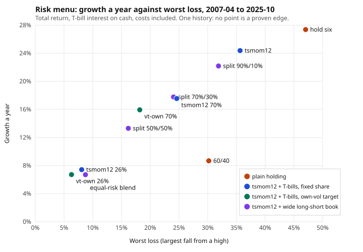

# Risk menu: which dial for which worry

Lane `risk-menu`, 2026-11-19. Card [`cards/risk-menu.md`](cards/risk-menu.md) (before any
number); full tables [`results/risk-menu.md`](results/risk-menu.md). Descriptive: **no pick**.
Eleven ways to hold the same six assets (SPY, QQQ, TLT, GLD, BTC, ETH), all on one footing:
April 2007 to October 2025, costs included, idle cash earning T-bills.

| If you care most about | Pick | Its number | Runner-up | What you give up |
|---|---|---:|---|---|
| Return per unit of risk (Sharpe above T-bills) | Own-vol target, 26% average share | 1.34 (SE 0.24) | own-vol target 70%: 1.33 | Nothing provable: 8 of the other 10 are inside its bootstrap range |
| Growth | Hold the six | 27.4% a year | `tsmom12`: 24.4% | A 47% worst loss, -36.5% in 2022 |
| A small worst loss | Own-vol target, 26% | 6.3% | `tsmom12` 26%: 8.1% | Growth 6.7% a year (bills averaged 1.4%) |
| A mild worst 12 months | Own-vol target, 26% | -3.2% | equal-risk blend: -4.2% | As above |
| Short time below an old high | Own-vol target, 26% | 1.3 years | equal-risk blend: 1.8 | As above; every other item 2.1-2.8 years |
| Gaining in a slow crash (2008) | Equal-risk blend with the wide long-short book | +10.4% | split 50/50: +7.5% | Sharpe 0.97, the lowest but 60/40; shorts on 34 ETFs, ~500 orders a year |
| Gaining in a fast crash (2020 Q1) | Equal-risk blend | +4.4% | hold six: +0.4% | As above |
| Gaining in a rate shock (2022) | Equal-risk blend | +4.1% | own-vol target 26%: +0.6% | As above |
| A middle size (worst loss under a quarter) | Own-vol target, 70% | 15.9% a year, worst loss 18.2%, worst 12 months -8.4% | `tsmom12` 70%: 17.6%, 24.6%, -20.6% | 1.7 points of growth a year for 6 points less worst loss |
| Fewest orders | 60/40 | 45 a year | `tsmom12`: 81 | Sharpe 0.66, 30% worst loss, -23% in 2022 |

**How sure.** Sharpe has a standard error of about 0.24 on these 18.6 years. Against holding
the six, every `tsmom12` form sits between -0.18 (equal-risk blend) and +0.19, with 5%..95%
ranges that all cross zero (only 60/40 is clearly behind). Own-vol targeting's +0.13 over
`tsmom12` (-0.09..+0.35) is the same small, unproven gain vol-timing found; its size (k) was set
in-sample. The project-wide
bar for a new pick is an edge of about +0.30 over `tsmom12` at Bonferroni p <= 4.9e-5 (N 1,012,
`register-1`; 1,027 on `register-3`). **No row is a proven edge: these are risk levels.**
Worst loss, worst 12 months, time under water and the crash columns come from one history and
carry no standard error; the crash columns rest on three episodes.

**Read this too.**

- Fixed shares keep `tsmom12`'s Sharpe and scale its losses; a 70% share has worst loss 24.6%
  here, the level of rp-1's `where-rp` (24.5% on 1994-2025). Own-vol targeting at the same 70% average share cut the worst
  loss to 18.2% and the worst 12 months from -20.6% to -8.4% on this history.
- Fixed splits with the wide long-short book cost little Sharpe up to 70/30 (1.21) and turn
  2008 positive, but help 2020 and 2022 less than the equal-risk blend, which holds about three
  quarters in the wide book. The wide book needs shorts the paper broker cannot hold.
- Growth is flattered by crypto (Bitcoin in the book from 2013, Ether from 2017): the more a
  row holds, the more. 2000-2002 is outside the window (see [`risk-map.md`](risk-map.md)).
- Orders for mixes are approximate (card); the held-out year is untouched.

Rows: 7 `replication` rows in `tries.md` (not selectable). Items: hold the six, 60/40,
`tsmom12` at 100 / 70 / 26%, own-vol target at 26 / 70%, the equal-risk blend, and splits
90/10, 70/30, 50/50 with `wide-LS-g1`.
